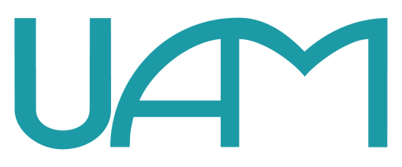
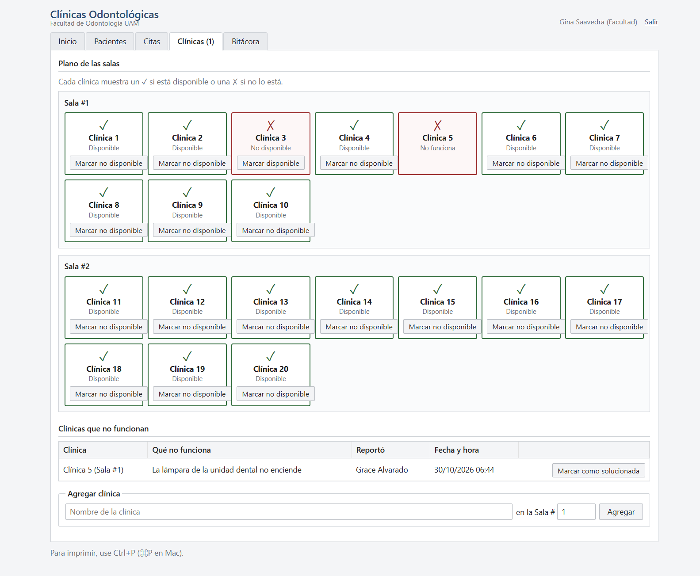
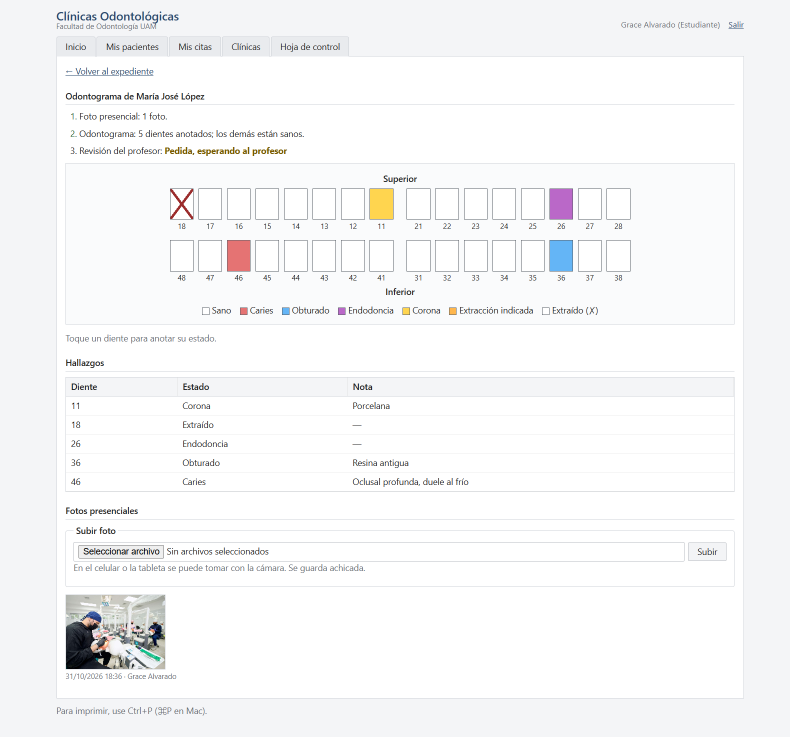
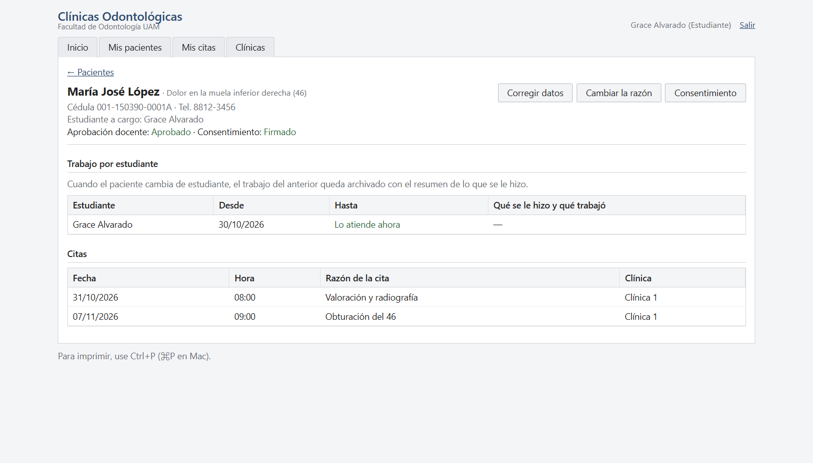

<p align="center">
  
</p>

<h1 align="center">Clínicas Odontológicas</h1>

<p align="center">
  Sistema web de gestión clínica para la Facultad de Odontología de la Universidad Americana (UAM), Nicaragua.<br>
  <a href="https://clinicas-odontologicas-uam.fly.dev">clinicas-odontologicas-uam.fly.dev</a>
</p>

---

Reemplaza los expedientes y controles en papel de las clínicas de la Facultad. Cada estudiante lleva a sus pacientes
desde el registro hasta el alta, el profesor supervisa y aprueba cada paso, y la Facultad administra las clínicas,
los cobros y los materiales. Funciona en computadora, tableta y celular, sin instalar nada.



## Qué hace

| Para el estudiante | Para el profesor | Para la Facultad |
|---|---|---|
| Registra pacientes y llena la historia clínica | Aprueba o rechaza pacientes con observaciones | Crea y administra las cuentas, también por grupo con QR |
| Toma el consentimiento firmado en la tableta | Revisa y aprueba los odontogramas | Asigna los turnos clínicos |
| Llena el odontograma con foto de evidencia | Firma la hoja de control de recibos | Lleva el plano de las 50 clínicas y sus fallas |
| Agenda citas sin choques de clínica ni de horario | Ve solo a los pacientes de sus estudiantes | Maneja el tarifario, las órdenes de cobro y el inventario |
| Envía recordatorios por WhatsApp | Sigue el plan de tratamiento y el alta | Consulta la bitácora de todo lo que pasa en el sistema |

Además: expediente en PDF, alertas por alergias y presión alta, radiografías, plan de tratamiento por fases,
indicaciones después de la atención y bot de WhatsApp para que el paciente confirme su cita.

| Odontograma | Expediente | En el celular |
|---|---|---|
|  |  |  |

## Seguridad y datos de pacientes

- Cada quien ve solo lo que le toca: el estudiante, sus pacientes; el profesor, los de sus estudiantes.
- Contraseñas cifradas, conexión segura, bloqueo tras 5 intentos fallidos y cierre de sesión a los 15 minutos.
- Las fotos y radiografías están en un almacén privado y se abren con un enlace que vence en 5 minutos.
- Toda acción queda en una bitácora que no se puede editar ni borrar.
- Respaldo automático diario de la base de datos.
- El consentimiento informado incluye la autorización del paciente según la Ley N.º 787 de Protección de Datos
  Personales. Detalle en [docs/ley-787.md](docs/ley-787.md).

## Cómo está hecho

| Parte | Herramienta |
|---|---|
| Programa | Python 3.14 con Flask, en un solo archivo: [`prototipo.py`](prototipo.py) |
| Pantallas | HTML con plantillas de Flask ([`templates/`](templates)) y un solo archivo de estilos |
| Base de datos | PostgreSQL en [Neon](https://neon.tech) |
| Fotos, radiografías y respaldos | Almacén privado compatible con S3 (Tigris, en Fly.io) |
| Publicación | [Fly.io](https://fly.io), automática desde GitHub al subir cambios a `main` |
| PDF | ReportLab |
| Recordatorios | API de WhatsApp Business (Meta) |

El diagrama de la base de datos está en [`diagrama-entidad-relacion.png`](diagrama-entidad-relacion.png).

## Correrlo en una computadora

Necesita Python 3.14 y una base PostgreSQL (una rama de Neon sirve).

```bash
pip install -r requirements.txt
export DATABASE_URL="<cadena de conexión de la base>"
export SECRET_KEY="<una frase larga y secreta>"
python prototipo.py
```

Abre en <http://localhost:5001>. La primera vez crea las tablas y las cuentas iniciales. Sin almacén configurado, las
fotos se guardan en la carpeta `archivos/`.

**Variables opcionales**

| Variable | Para qué |
|---|---|
| `ALMACEN_BUCKET`, `ALMACEN_ENDPOINT`, `ALMACEN_ID`, `ALMACEN_CLAVE`, `ALMACEN_REGION` | Almacén privado de fotos y respaldos (obligatorio en Fly) |
| `CLAVE_INICIAL` | Contraseña de las cuentas que se crean por primera vez |
| `SITIO` | Dirección pública del sistema, usada en los QR y en WhatsApp |
| `COMENTARIOS` | Enlace al formulario de comentarios |
| `WHATSAPP_*`, `CLINICA_UBICACION` | Recordatorios y bot de WhatsApp, ver [docs/recordatorios-whatsapp.md](docs/recordatorios-whatsapp.md) |

**Comandos**

| Comando | Qué hace |
|---|---|
| `flask --app prototipo crear-tablas` | Crea o actualiza las tablas (se corre solo en cada publicación) |
| `flask --app prototipo respaldar` | Guarda un respaldo de la base en el almacén |
| `flask --app prototipo restaurar <archivo>` | Restaura un respaldo en una base vacía |
| `flask --app prototipo recordar` | Envía los recordatorios de las citas de mañana |

## Pruebas

Las dos pruebas **borran la base que usan**: córralas siempre en una rama de Neon aparte, nunca en la real.

```bash
PRUEBAS_DATABASE_URL="<rama de pruebas>" python pruebas.py   # pruebas del sistema
CARGA_DATABASE_URL="<rama de pruebas>" python carga.py       # 50 usuarios a la vez
```

La prueba de carga del 16 de noviembre de 2026 respondió el 95 % de las páginas en 0,05 s con 50 usuarios a la vez
y sin errores. Plan y resultados en [docs/plan-de-pruebas.md](docs/plan-de-pruebas.md).

## Publicar

Cada cambio que llega a `main` se publica solo en Fly.io con GitHub Actions
([`.github/workflows/desplegar.yml`](.github/workflows/desplegar.yml)). Al publicar se actualizan las tablas de la
base real, así que todo cambio a `main` debe estar probado antes.

## Documentos

| Documento | Contenido |
|---|---|
| [`guia-defensa.pdf`](guia-defensa.pdf) | Guía de uso de 15 minutos, con capturas |
| [docs/plan-de-pruebas.md](docs/plan-de-pruebas.md) | Usabilidad, rendimiento, portabilidad y disponibilidad |
| [docs/cuestionario-sus.md](docs/cuestionario-sus.md) | Cuestionario de facilidad de uso, listo para imprimir |
| [docs/ley-787.md](docs/ley-787.md) | Cómo cumple el sistema la ley de protección de datos |
| [docs/respaldos.md](docs/respaldos.md) | Respaldos y cómo restaurarlos |
| [docs/recordatorios-whatsapp.md](docs/recordatorios-whatsapp.md) | Configuración de WhatsApp |

## Derechos

© 2026 Equipo de desarrollo de Clínicas Odontológicas. Todos los derechos reservados.

El código se puede consultar en este repositorio, pero no se permite copiarlo, modificarlo, distribuirlo ni usarlo
sin autorización escrita de sus autores.
