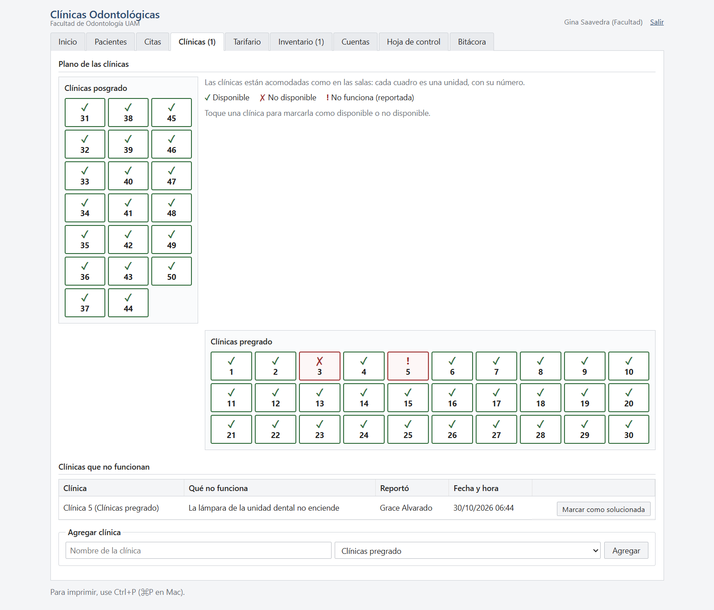
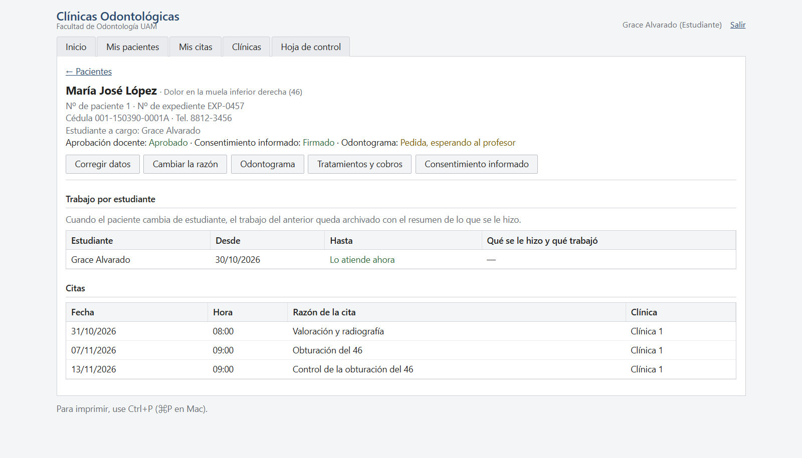
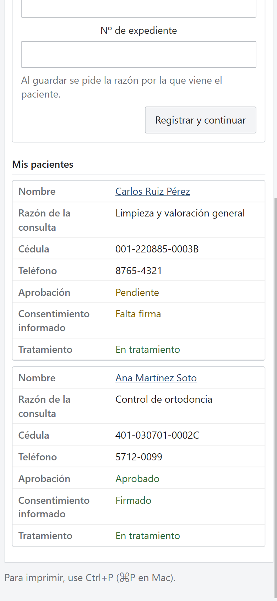

<p align="center">
  
</p>

<h1 align="center">Clínicas Odontológicas</h1>

<p align="center">
  Sistema web de gestión clínica para la Facultad de Odontología de la Universidad Americana (UAM), Nicaragua.<br>
  <a href="https://clinicas-odontologicas-uam.fly.dev">clinicas-odontologicas-uam.fly.dev</a>
</p>

---

Reemplaza los expedientes y controles en papel de las clínicas de la Facultad. Cada estudiante lleva a sus pacientes
desde el registro hasta el alta, el profesor supervisa y aprueba cada paso, y la Facultad administra las clínicas,
los cobros y los materiales. Funciona en computadora, tableta y celular, sin instalar nada.



## Qué hace

| Para el estudiante | Para el profesor | Para la Facultad |
|---|---|---|
| Entra a la clase de su profesor con un código QR | Crea sus clases y los códigos QR de sus estudiantes | Crea y administra las cuentas |
| Registra pacientes y llena la historia clínica | Aprueba o rechaza pacientes con observaciones | Asigna los turnos clínicos |
| Toma el consentimiento firmado en la tableta | Aprueba las citas y los tratamientos de sus estudiantes | Lleva el plano de las 50 clínicas y sus fallas |
| Llena el odontograma con fotos y radiografías | Revisa y aprueba los odontogramas | Maneja el tarifario, los pagos y el inventario |
| Agenda citas sin choques de clínica ni de horario | Genera órdenes de cobro y firma los recibos | Consulta la bitácora de todo lo que pasa en el sistema |
| Envía recordatorios por WhatsApp | Ve solo a los estudiantes de sus clases | Ve todo lo que pasa en el sistema |

Además: expediente en PDF, alertas por alergias y presión alta, radiografías, plan de tratamiento por fases,
indicaciones después de la atención y bot de WhatsApp para que el paciente confirme su cita.

| Odontograma | Expediente | En el celular |
|---|---|---|
|  |  |  |

## Seguridad y datos de pacientes

- Cada quien ve solo lo que le toca: el estudiante, sus pacientes; el profesor, los de sus estudiantes.
- Contraseñas cifradas, conexión segura, bloqueo tras 5 intentos fallidos y cierre de sesión a los 15 minutos.
- Las fotos y radiografías están en un almacén privado y se abren con un enlace que vence en 5 minutos.
- Toda acción queda en una bitácora que no se puede editar ni borrar.
- Respaldo automático diario de la base de datos.
- El consentimiento informado incluye la autorización del paciente según la Ley N.º 787 de Protección de Datos
  Personales. Detalle en [documentacion/legal/proteccion-de-datos-ley-787.md](documentacion/legal/proteccion-de-datos-ley-787.md).

## Cómo está hecho

| Parte | Herramienta |
|---|---|
| Programa | Python 3.14 con Flask, en un solo archivo: [`prototipo.py`](prototipo.py) |
| Pantallas | HTML con plantillas de Flask ([`templates/`](templates)) y un solo archivo de estilos |
| Base de datos | PostgreSQL en [Neon](https://neon.tech) |
| Fotos, radiografías y respaldos | Almacén privado compatible con S3 (Tigris, en Fly.io) |
| Publicación | [Fly.io](https://fly.io), automática desde GitHub al subir cambios a `main` |
| PDF | ReportLab |
| Recordatorios | API de WhatsApp Business (Meta) |

## Estructura del repositorio

Cada carpeta y archivo lleva el nombre de lo que hace.

```
├── prototipo.py               Aplicación web (Flask): rutas, roles, validaciones y comandos de mantenimiento
├── templates/                 Pantallas del sistema, una por archivo:
│   ├── plantilla-base.html        cabecera y pestañas comunes a todas
│   ├── inicio-de-sesion.html, inicio.html, politica-de-privacidad.html
│   ├── pacientes.html, expediente-del-paciente.html, editar-paciente.html, razon-de-consulta.html,
│   │   historia-clinica.html, consentimiento-informado.html, odontograma.html,
│   │   tratamientos-del-paciente.html, orden-de-cobro.html, traspaso-de-paciente.html,
│   │   dar-de-alta-o-eliminar-paciente.html
│   ├── citas.html, clinicas.html, hoja-de-control.html
│   ├── clases.html, detalle-de-clase.html, registro-de-estudiante.html, cuentas.html, editar-cuenta.html
│   └── tarifario.html, inventario.html, materiales.html, bitacora.html, comentarios.html
├── static/                    Archivos que descarga el navegador:
│   └── estilos.css, envio-de-formularios.js, logo-uam.png, icono-de-pestana.svg, fondo-inicio-de-sesion.jpg
├── base-de-datos/             esquema.sql: tablas del modelo de datos v14
├── pruebas/                   pruebas_del_sistema.py (más de 150 casos) y prueba_de_carga.py (50 usuarios)
├── migraciones/               migrar_al_modelo_v14.py: pasa una base del modelo anterior al v14 (una sola vez)
├── documentacion/
│   ├── diagramas/                 casos de uso y entidad-relación
│   ├── guia-de-uso/               guía de defensa (HTML y PDF) y sus capturas de pantalla
│   ├── operacion/                 respaldos y recordatorios por WhatsApp
│   ├── pruebas/                   plan de pruebas y cuestionario de usabilidad SUS
│   └── legal/                     protección de datos (Ley N.º 787)
├── .github/workflows/         publicar-en-fly.yml: publica en Fly.io cada cambio que llega a main
├── requirements.txt           librerías de Python que usa la aplicación
├── Dockerfile, fly.toml       cómo se construye y publica la aplicación en Fly.io
└── .gitignore, .dockerignore, .gitattributes   qué no se sube a GitHub, qué no entra en la publicación y formato de líneas
```

`prototipo.py`, `templates/` y `static/` conservan su nombre porque así los buscan Flask, Gunicorn y las máquinas
programadas de Fly; el resto de nombres es libre.

## Modelo de datos

La base sigue el **modelo de datos v14**: 20 tablas, todas las relaciones 1:N salvo dos 1:1, sin muchos a muchos.
El diagrama está en [`documentacion/diagramas/diagrama-entidad-relacion.png`](documentacion/diagramas/diagrama-entidad-relacion.png) (fuente:
[`diagrama-entidad-relacion.drawio`](documentacion/diagramas/diagrama-entidad-relacion.drawio)) y el SQL en [`base-de-datos/esquema.sql`](base-de-datos/esquema.sql).

Lo principal:

- Las cuentas tienen un `id` fijo; el CIF es único pero se puede corregir. Los roles son estudiante, profesor y facultad.
- Cada estudiante está en una clase a la vez y entra con un código QR de un solo uso que genera su profesor. El
  profesor solo aprueba a los estudiantes de sus clases.
- Las citas tienen inicio y fin, clínica obligatoria y horario de lunes a sábado de 07:00 a 16:00. Las que agenda el
  estudiante esperan la aprobación de su profesor; las que agenda el profesor ya van aprobadas.
- Un tratamiento realizado apunta a la cita en que se hizo: de ella salen quién lo hizo y cuándo.
- Los pagos son recibos de una orden de cobro. El total, lo pagado y el saldo los calcula la vista `resumen_ordenes`.
- La cantidad de cada material sale de sus movimientos de inventario (vista `existencias`), que no se editan.

[`base-de-datos/esquema.sql`](base-de-datos/esquema.sql) es el modelo v14 con tres ajustes marcados `[ajuste]`:

1. Una llave diferible entre cuentas y clases, para poder cargar respaldos.
2. Las reglas de rol se revisan al crear la fila o cuando cambia la persona, y no al cargar un respaldo.
3. La aprobación de una cita se revisa cuando se da.

Al final tiene las **extensiones**, columnas y tablas que no están en el diagrama y que conservan funciones que el
sistema ya tenía: el bloqueo de la cuenta, el consentimiento firmado, la razón de la consulta, el rechazo con su
observación, la revisión del odontograma, el alta y la eliminación del paciente, el resto de la historia clínica,
los recordatorios por WhatsApp, la foto de los recibos, los traspasos y los pedidos de contacto.

Una base del modelo anterior se pasa al v14 con [`migraciones/migrar_al_modelo_v14.py`](migraciones/migrar_al_modelo_v14.py), siempre en una rama nueva de Neon.
Mientras la base no esté migrada, el sistema no arranca.

## Correrlo en una computadora

Necesita Python 3.14 y una base PostgreSQL (una rama de Neon sirve).

```bash
pip install -r requirements.txt
export DATABASE_URL="<cadena de conexión de la base>"
export SECRET_KEY="<una frase larga y secreta>"
python prototipo.py
```

Abre en <http://localhost:5001>. La primera vez crea las tablas y las cuentas iniciales. Sin almacén configurado, las
fotos se guardan en la carpeta `archivos/`.

**Variables opcionales**

| Variable | Para qué |
|---|---|
| `ALMACEN_BUCKET`, `ALMACEN_ENDPOINT`, `ALMACEN_ID`, `ALMACEN_CLAVE`, `ALMACEN_REGION` | Almacén privado de fotos y respaldos (obligatorio en Fly) |
| `CLAVE_INICIAL` | Contraseña de las cuentas que se crean por primera vez |
| `SITIO` | Dirección pública del sistema, usada en los QR y en WhatsApp |
| `COMENTARIOS` | Enlace al formulario de comentarios |
| `WHATSAPP_*`, `CLINICA_UBICACION` | Recordatorios y bot de WhatsApp, ver [documentacion/operacion/recordatorios-whatsapp.md](documentacion/operacion/recordatorios-whatsapp.md) |

**Comandos**

| Comando | Qué hace |
|---|---|
| `flask --app prototipo crear-tablas` | En una base vacía crea las tablas del modelo v14 (se corre solo en cada publicación) |
| `MIGRAR_DATABASE_URL=<rama> python migraciones/migrar_al_modelo_v14.py` | Pasa una base del modelo anterior al v14 (una sola vez, en una rama nueva) |
| `flask --app prototipo respaldar` | Guarda un respaldo de la base en el almacén |
| `flask --app prototipo restaurar <archivo>` | Restaura un respaldo en una base vacía |
| `flask --app prototipo recordar` | Envía los recordatorios de las citas de mañana |

## Pruebas

Las dos pruebas **borran la base que usan**: córralas siempre en una rama de Neon aparte, nunca en la real. Se
corren desde la raíz del repositorio.

```bash
PRUEBAS_DATABASE_URL="<rama de pruebas>" python -m pruebas.pruebas_del_sistema   # pruebas del sistema
CARGA_DATABASE_URL="<rama de pruebas>" python -m pruebas.prueba_de_carga       # 50 usuarios a la vez
```

La prueba de carga del 16 de noviembre de 2026 respondió el 95 % de las páginas en 0,05 s con 50 usuarios a la vez
y sin errores. Plan y resultados en [documentacion/pruebas/plan-de-pruebas.md](documentacion/pruebas/plan-de-pruebas.md).

## Publicar

Cada cambio que llega a `main` se publica solo en Fly.io con GitHub Actions
([`.github/workflows/publicar-en-fly.yml`](.github/workflows/publicar-en-fly.yml)). Al publicar se actualizan las tablas de la
base real, así que todo cambio a `main` debe estar probado antes.

## Documentos

| Documento | Contenido |
|---|---|
| [`documentacion/guia-de-uso/guia-de-defensa.pdf`](documentacion/guia-de-uso/guia-de-defensa.pdf) | Guía de uso de 15 minutos, con capturas (fuente: `documentacion/guia-de-uso/guia-de-defensa.html`) |
| [`documentacion/diagramas/diagrama-casos-de-uso.png`](documentacion/diagramas/diagrama-casos-de-uso.png) | Diagrama de casos de uso (vista de escenarios, Enterprise Architect) |
| [`documentacion/diagramas/diagrama-entidad-relacion.png`](documentacion/diagramas/diagrama-entidad-relacion.png) | Modelo de datos v14 |
| [`documentacion/pruebas/plan-de-pruebas.md`](documentacion/pruebas/plan-de-pruebas.md) | Usabilidad, rendimiento, portabilidad y disponibilidad |
| [`documentacion/pruebas/cuestionario-de-usabilidad-sus.md`](documentacion/pruebas/cuestionario-de-usabilidad-sus.md) | Cuestionario de facilidad de uso, listo para imprimir |
| [`documentacion/legal/proteccion-de-datos-ley-787.md`](documentacion/legal/proteccion-de-datos-ley-787.md) | Cómo cumple el sistema la ley de protección de datos |
| [`documentacion/operacion/respaldos.md`](documentacion/operacion/respaldos.md) | Respaldos y cómo restaurarlos |
| [`documentacion/operacion/recordatorios-whatsapp.md`](documentacion/operacion/recordatorios-whatsapp.md) | Configuración de WhatsApp |

## Derechos

© 2026 Equipo de desarrollo de Clínicas Odontológicas. Todos los derechos reservados.

El código se puede consultar en este repositorio, pero no se permite copiarlo, modificarlo, distribuirlo ni usarlo
sin autorización escrita de sus autores.
